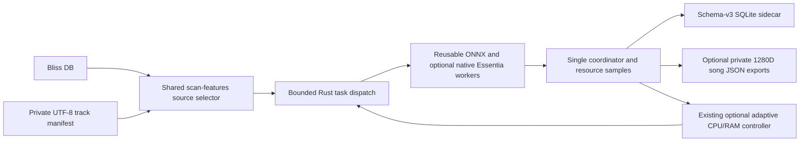

# Explicit track-manifest analysis using the existing adaptive worker scanner

> **Product-scope update, 28 Oct 2026:** The supported manifest batch scanner in [PR #20](https://github.com/chrober/bliss-mood-poc/pull/20) uses fixed worker capacity and optionally one-time CPU-based `--workers auto`. Historical `--adaptive-workers` examples here are retained as research context **but do not work with the final CLI**. See [final multi-worker architecture and CLI commands](multi-worker-song-analysis-final.md). Native C++ executable/DLL distribution remains subject to separate blocked license review.


> **28 OCTOBER 2026 UPDATE:** This document covers the original
> manifest feature and its early CI sequence, and includes now-historical
> "not yet measured" statements. See the [current PR #18 worker-sizing and
> performance handover](handover-adaptive-host-sizing-20261028.md) for
> verified **30-scan priority** and **10-scan adaptive-policy** results,
> system-dependent `--max-workers auto` implementation, current CI
> and next native fixed 6/8/10/12 performance experiment.

**Status:** experimental implementation on `feat/manifest-batch-adaptive-worker-analysis`; based on the exact PR #17 C++/Rust backend. This is **not** a release qualification or a measured performance improvement. PR #16 remains unaffected.

## Problem and scope

Research and dataset utilities have historically spawned a new `analyze-features` process for every track. `--threads 1` prevents intra-track ONNX oversubscription, but does not parallelize tracks or reuse ONNX sessions across separate processes. The existing `scan-features` scheduler already has reusable per-worker ONNX sessions, bounded in-flight dispatch, one transactional SQLite coordinator and an optional resource-guard controller.

The new `--tracks-file` source allows an **explicit cohort** to enter that existing scheduler **without manufacturing a Bliss database**. It persists genre/mood/voice classification features in a separate schema-v3 SQLite sidecar. With explicit `--embedding-dir` it also exports **one pooled, L2-normalized 1280D Discogs-EffNet embedding per song**. This reuses the f64 pooling and fingerprint contract of PR #16's research overlay; it does not dump all per-patch vectors. A synthetic-audio integration test has established **exact numerical equality across serial, fixed-two-worker and adaptive-two-worker runs**, including pooled embedding JSON and persisted head bytes; independent real-song acceptance and held-out musical usefulness remain open. No change to `analyze-features`, existing `--bliss-db` scans or the original Bliss DB.

### Source manifest

- UTF-8 plain text, one exact **source-root-relative** track key per line; empty lines ignored. The order in the manifest is preserved for *dispatch*, not for asynchronous completion.
- Forward slash separators; no absolute paths, drive designators, backslashes, leading/trailing whitespace, empty path components, `.`, `..` or duplicate keys.
- Existing symlink targets are checked against the canonical source root before work starts. Missing files are subsequently counted by the scan's normal error/limit mechanism. Source audio is read-only.
- Maximum 100,000 selected keys and **32 MiB UTF-8 manifest input** to avoid unbounded input. Use modest samples first. Manifest filenames can be private; never commit a real cohort or track-specific logs.
- `--tracks-file` requires `--source-root` and is mutually exclusive with `--bliss-db`; `--library-root` is Bliss-only. `--only-track` and `--max-new` remain supported.
- `--embedding-dir` requires a manifest and a pre-existing private output directory outside music and model roots. It is forbidden in dry-run. SHA256(track key) names the JSON file, so filenames do not disclose track identities.
- Each embedding JSON includes the original track identity **inside** the private file, audio SHA256, 1280 dimensions, patch count, exact encoder SHA256, preprocessing version, pooling/normalization algorithms and reproducible representation fingerprint. This output is experimental, not a validated musical metric.

Example manifest, using **synthetic filenames only**:

```text
example-artist/example-album/01-test.wav
example-artist/example-album/02-test.flac
```

### PowerShell example (Windows, separate sidecar)

Use the verified binary for the selected commit after successful GitHub Actions checks. Never compile Rust locally on the user's Windows machine. Supply your own private paths locally; do not paste absolute paths or the manifest into public CI.

```powershell
& {
    $ErrorActionPreference = 'Stop'
    $exe = 'C:\path\to\verified\bliss-mood.exe'
    $manifest = 'C:\private\selected-tracks.txt'
    $sourceRoot = 'C:\private\test-audio'
    $sidecar = 'C:\private\manifest-features-new.db'
    $models = 'C:\private\official-models'
    $embeddingDir = 'C:\private\private-song-embeddings'
    foreach ($p in @($exe, $manifest, $sourceRoot, $models)) {
        if (-not (Test-Path -LiteralPath $p)) { throw "Missing prerequisite: $p" }
    }
    if (Test-Path -LiteralPath $sidecar) { throw 'Refusing to overwrite an existing sidecar' }
    if (-not (Test-Path -LiteralPath $embeddingDir)) {
        New-Item -ItemType Directory -Path $embeddingDir -ErrorAction Stop | Out-Null
    }

    & $exe scan-features --tracks-file $manifest --source-root $sourceRoot `
        --db $sidecar --embedding-dir $embeddingDir --models-dir $models --models moodtheme,genre,voice `
        --threads 1 --workers 4 --max-new 100 --max-errors 5 --json
    if ($LASTEXITCODE -ne 0) { throw "Analysis failed with exit code $LASTEXITCODE" }
}
```

For optional resource-aware adjustment add `--adaptive-workers --min-workers 2 --max-workers 4` while starting at `--workers 3`. Adaptive mode is **not** a measured throughput optimizer. Start with fixed 1, 2 and 4 worker runs on independently copied sidecars; use identical manifest/model/audio SHA hashes. Do not use 8+ workers uncritically on hosted CI machines.

For a dry-run (no ONNX inference or SQLite writes), append `--dry-run` and omit both `--adaptive-workers` **and** `--embedding-dir`. Dry-run still validates the selected catalog and source mapping.

### Embedding correctness and resume

Opt-in song embedding accumulation is per worker and uses a single 1280-element f64 vector, not an in-memory list of every patch. The same encoder vectors are simultaneously classified by Mood/Genre/Voice; the existing head aggregation is unchanged.

A track is up-to-date only when its SQLite state/model identity matches and, if enabled, its JSON embedding is present and has matching SHA/preprocessing/fingerprint/patch count plus a finite, unit-length 1280D vector. Missing JSON triggers reanalysis. Corrupt or incompatible existing JSON fails closed: no existing output is overwritten. Reanalysis matching a previous complete file reuses that file. The output write happens before the SQLite feature transaction, so an interruption may leave a valid embedding without a refreshed sidecar; the next run re-verifies it. Embedding publication now stages a sibling temporary file, flushes and syncs it, then uses a same-directory **atomic, no-overwrite hard link** to publish the complete JSON. A crash before publication can leave a `.partial` file but not a partially published `.json`. On filesystems without hard-link support, creation fails closed; no unsafe rename fallback is used. Pre-existing damaged JSON requires explicit manual investigation, never silent replacement.

### Implementation and invariants



The classification calculations, native-backend preprocessing fingerprint, model hashes, persistence transaction and ONNX single-environment contract are **unchanged**. The existing scheduler does not terminate jobs when lowering concurrency; it dispatches fewer *new* jobs until outstanding work drains. Completed tracks are resumed through existing file size/mtime and model identity checks. A failed track can be retried safely after fixing the input; the existing `--max-errors` gate still applies.

**Limitations:** The source-root containment precheck runs before analysis but does not make an adversarial filesystem immune to time-of-check/time-of-use races. A private audio collection must be controlled by the user. Feature output ordering in SQLite must be queried by explicit track key/order; asynchronous worker completion is nondeterministic. Model numerical parity is inherited from the unchanged implementation, but the newly introduced manifest route still requires CI and a follow-up known-song comparison. No controlled wall-time/CPU/RAM numbers have yet been collected for the new option.

## Validation and next work

1. Rust unit test: accepted order, duplicates, traversal, absolute paths and backslashes. Run `cargo test --locked`, `cargo clippy --locked --all-targets -- -D warnings` and `cargo fmt --check` in CI.
2. **PASS on GitHub Actions**, 2026-10-22: [real official-ONNX synthetic-cohort test](https://github.com/chrober/bliss-mood-poc/actions/runs/39757431757), commit `31c10bee575d66b058ea23f0e4301f38189f2e49`. It generated three independent 4-second sine WAVs, ran serial/fixed-two/adaptive-two, and checked exact equality of schema-v3 score blobs, complete 1280D JSON vectors and provenance fingerprints; full resume skipped all songs, missing JSON caused exactly one reanalysis yielding byte-identical output, corrupted output refused overwrite. The small scans took 0.490s, 1.380s and 1.374s respectively **including startup/model loading**; this is *not* a parallel throughput benchmark or evidence of an adaptive speedup. The atomic publication and manifest-byte-bound changes require separate CI qualification at their respective final code commits.
3. Use the same controlled public dataset cohort for sequential/fixed/adaptive AB/BA benchmarking; split cold/warm cache and model load/decode/preprocess/inference timing. Do not conflate synthetic CI smoke times with production performance (pending).
4. Validate new pooled 1280D song exports against PR #16's independent validator on the same public cohort, audit crash-safe atomic output handling on Windows filesystems, and integrate with the currently pinned per-song research exporter only in a separately coordinated change (pending).
5. Integrate the reviewed changes into the relevant long-term branch only after PR #17's license/distribution release gates are separately resolved.

## First controlled synthetic fixed-worker ABBA benchmark (22 October 2026)

A dedicated, independent runner script
[`scripts/benchmark_manifest_fixed_workers.py`](../scripts/benchmark_manifest_fixed_workers.py)
now runs **eight synthetic 20-second WAV songs** with original ONNX inference
in fixed worker order **1, 2, 2, 1**, on distinct fresh SQLite sidecars and
embedding output directories. Exact serialized classifier score blobs and
complete song embeddings **must match**, or the CI step fails. This is an
exploratory throughput diagnostic, not a public-data musical benchmark.

The first [successful GitHub Actions run](https://github.com/chrober/bliss-mood-poc/actions/runs/39760717124)
on commit `b396d357a6381a2f411980efac0afd27620cceca` measured these
wall-clock durations **including startup and pre-worker measurements**:

| Workers | First run | Second run | Median |
|---|---:|---:|---:|
| 1 | 1.544 s | 1.486 s | 1.515 s |
| 2 | 1.821 s | 1.816 s | 1.819 s |

All outputs had **exact numerical equality**; two simultaneous analyses
were observed for the two-worker scans. These data **do not show a total
wall-clock speedup** from two workers for this synthetic eight-song workload.

**Major confound discovered by inspection:** the existing parallel scanner
calls `scan_resource_baseline()`, which intentionally sleeps **one second**
before dispatching workers to measure system CPU. The serial scanner does
not. Thus the short-run median unfairly compares a required ~1-second
parallel-mode observation with no corresponding serial observation. A
follow-up commit `933112af...` adds the *actual measured* pre-worker
baseline interval and a separate baseline-excluded wall-time estimate to
the benchmark output, **without concealing the real end-to-end cost**.
Baseline-adjusted measures are diagnostic only. The new step's CI
verification remains separate from the historical completed run.

The cohort consists only of generated steady tones, runs on a shared
GitHub-hosted Linux VM, has two repetitions per configuration, and is too
short to exercise adaptive adjustments or produce reliable CPU/RAM sample
aggregates. Proper performance qualification still requires representative
longer public recordings, fixed runner conditions, separate load/decode/
preprocess/inference timings, and ultimately optional private Windows/NAS
benchmarks with no music uploaded to GitHub.

## Original Essentia C++ multiworker gate and adaptive admission (22 October 2026)

**Goal:** establish that the *original upstream Essentia C++ subprocess backend*
retains the Rust orchestrator's fixed and adaptive concurrency semantics. Do
not infer backend performance from Rust-front-end timings or merely from an
`--adaptive-workers` flag being accepted.

- `scripts/verify_native_essentia_worker_concurrency.py` runs the **actual
  `scan-features --audio-backend essentia`** binary with 1, 2 and 4 fixed song
  workers plus an adaptive-enabled 2-worker baseline. Eight generated 20-second
  WAV inputs use only official ONNX weights. All variants must analyze exactly
  eight tracks on distinct sidecars, show the requested concurrent Rust
  analyses, and yield **bitwise identical** stored classification blobs and
  equal complete 1280D pooled embedding JSONs. The Rust worker threads each
  own an independent long-lived native C++ child; no silent Rust DSP fallback.
- The native Linux workflow compiles pinned upstream Essentia and the original
  C++ child, then builds the real Rust/ONNX scanner and runs the new gate.
  Existing original C++/Rust codec/Mel/model-parity checks stay mandatory.
  [Native workflow run at `db79beb1`](https://github.com/chrober/bliss-mood-poc/actions/runs/39767213632):
  **running at the time of documentation**. Do not report a native concurrency
  PASS until this particular gate completes.
- The real production coordinator now delegates dispatch admission to
  `AdaptiveWorkers::permits_dispatch(in_flight)`. A deterministic test passes
  controlled monotonic timestamps through the **same** observation/policy
  implementation: it confirms the 24-completed-song gate, 20-second cooldown,
  increase 2→3 under headroom and reduction 3→2 under CPU pressure, and
  corresponding rejection/admission at the new active cap. This does **not**
  inject fake load into any deployed analyzer.
  [Rust checks at `080a4cd1`](https://github.com/chrober/bliss-mood-poc/actions/runs/39768072854)
  **PASS**.
- **Not yet demonstrated:** adaptive resizing during a real C++ song scan.
  The eight-song smoke is too short for the policy's 24-song gate. CPU/RAM
  telemetry alone is also *not* a throughput-feedback optimizer. For the
  next gate use a longer bounded public cohort (at least 30 songs), allow the
  unmodified 20-second policy cooldown, and observe genuine `adjustments`
  in the scanner JSON. If using induced OS load, isolate it from performance
  comparisons, record exact conditions, and never assert deterministic
  adjustment under uncontrolled CI runner load.
- For a meaningful native performance decision, compare fixed 1/2/4/6 and
  adaptive operation with the **same** representative local NAS cohort, fresh
  sidecars, model weights and native binary SHA, balanced run order, separate
  Rust/C++ process-tree memory diagnostics and source-file/sidecar read-only
  invariants. The pre-worker CPU baseline adds about one second to parallel
  scan wall time; report it separately without removing it from end-to-end
  runtime. Do not upload personal audio, feature sidecars or track manifests.

### Native CI failure and runner compatibility (22 October 2026)

The [native C++ workflow run 39768344277](https://github.com/chrober/bliss-mood-poc/actions/runs/39768344277)
at `28d8caff` **failed after all its original Essentia C++ codec, Mel and
ONNX comparison steps PASSED**. The new actual Rust `scan-features` binary
failed to link against its prebuilt static ONNX Runtime archive on
`ubuntu-22.04`: `__isoc23_strtol`, `__isoc23_strtoull`,
`__isoc23_strtoll`, and `std::__cxx11::basic_string::_M_replace_cold`
were unresolved. These newer glibc (2.38+) and libstdc++ (GCC 13+) ABI
requirements come from the downloaded `ort` library, not from original
Essentia's C++ subprocess or failed ONNX inference. Therefore the **new C++
1/2/4-worker test was SKIPPED** at that commit; do not count it as PASS.

The workflow now targets `ubuntu-24.04`, whose glibc/libstdc++ satisfy the
linker's ABI requirements, with an OS-separated Essentia Waf cache key.
This raises the **CI native Linux executable build baseline** to Ubuntu
24.04; it is NOT proof of compatibility with Ubuntu 22.04 or older.
Support for older Linux distributions requires a different ONNX runtime
linking/distribution strategy, independently of the C++ worker.

The same failed native job spent about **33m 41s** in its quiet APT metadata
refresh, while [successful Voice run 39768344281](https://github.com/chrober/bliss-mood-poc/actions/runs/39768344281)
spent about **19m** in its APT step. Both later installed packages
successfully, and the Voice run downloaded official model files and passed.
The precise mirror/network cause cannot be inferred from the quiet logs;
there is no demonstrated connection to a PHP outage. The native and Voice
workflows now emit APT phase timestamps, show non-quiet APT diagnostics,
retry transient fetch failures and cap update and install periods explicitly.
Any resulting CI failures will be easier to triage than silent 20-30-minute
stalls. The new runner/cache change remains **unqualified until its own
workflow completes**.

The next [native workflow run 39775819256](https://github.com/chrober/bliss-mood-poc/actions/runs/39775819256)
at `2da0c016` also failed during Essentia compilation on Ubuntu 24.04.
The October 2026 Essentia upstream pin had progressed **beyond** the
available Ubuntu 24.04 FFmpeg version and referenced
`avcodec_get_supported_config` / `AV_CODEC_CONFIG_SAMPLE_FORMAT`,
which are not available there. This is independent of the glibc error
and of any parallel scheduler change.

The follow-up pins the unmodified **10 December 2025-era upstream commit
`828532642f987c5c83f7686347bf9634dd3b821d`**, which already uses
the post-FFmpeg-5 encoding API while retaining the FFmpeg-6-compatible
`AVCodec.sample_fmts` query. The Essentia C++ cache key is independently
bumped again. This compatibility choice is **hypothesized from upstream
source inspection, not yet CI-qualified**. The full original C++ vs Rust
Mel/codec/model parity checks remain strict; the subsequent scanner
1/2/4-worker test must still run and pass. Do not treat the earlier
2023 or October 2026 upstream versions' parity results as direct evidence
for the new pin.

### Current upstream: pin latest Essentia, supply an appropriate modern FFmpeg

The December 2025 intermediate fallback `82853264` also failed
([run 39776970042](https://github.com/chrober/bliss-mood-poc/actions/runs/39776970042)):
the worker executable could not link
`essentia::streaming::AudioLoader::FFMPEG_BUFFER_SIZE`. Selecting
arbitrary historic Essentia commits is **not our long-term strategy**.

The native Linux CI instead tests the unmodified current original
upstream Essentia commit `dc91e47ed634e0b152d3d0229ec86751bb315473`
(14 October 2026) against pinned official **FFmpeg 9.0.2**, whose
`n9.0.2` source release resolves to
`946fcce07b6dcd0331c8cc609192aeff5e1924f8`.
Modern FFmpeg is built separately and exposed through an isolated
`PKG_CONFIG_PATH`/`LD_LIBRARY_PATH` prefix, not by upgrading random
Ubuntu packages. Both dependency trees have independently
versioned/ABI-specific CI caches. Ubuntu 24.04 is retained to satisfy the
prebuilt ONNX Runtime's glibc/libstdc++ requirements.

The word *latest* is the upstream maintenance **target**, not permission
for nondeterministic builds from a moving branch. Every tested and
distributable binary must record and verify an exact upstream SHA,
FFmpeg release/commit, runner OS ABI and model provenance. Periodic
dependency update PRs should advance these pins after passing the strict
native codec/Mel/ONNX numerical parity, SQLite and 1/2/4 fixed/adaptive
concurrency gates. Reproducibility and current dependencies are compatible.

**Status:** this is an experimental CI compatibility change, not an
approved Linux release. New Essentia decoding behavior can affect model
results; do not relax numerical tolerances just to pass. Native FFmpeg 9
shared libraries need separate distribution, library path and license
verification for supported end-user platforms.

### October 22 APT download failures and reduced CI dependency surface

At commit `53ac45b5`, **both** the native C++ CI
([run 39778787823](https://github.com/chrober/bliss-mood-poc/actions/runs/39778787823))
and Voice parity CI ([run 39778787752](https://github.com/chrober/bliss-mood-poc/actions/runs/39778787752))
failed with exit code `124` from our eight-minute `timeout 480s` wrapper
around `apt-get install`. The mirror `azure.archive.ubuntu.com` was serving
archives very slowly. The native job requested **127 MB** for 121 new packages;
the Voice job requested **94.1 MB** for 99 new packages. Neither reached
FFmpeg 9 compilation or its existing audio/model parity checks. These are
APT-download failures, not evidence of broken classifications or a PHP attack.

We should avoid downloading an entire system FFmpeg multimedia dependency
tree just to generate four synthetic test files. Both CI workflows now install
**CI-only, version-pinned `imageio-ffmpeg==0.6.0`** through pip and expose its
bundled Linux x86_64 `ffmpeg` executable via
`scripts/prepare_ci_ffmpeg.py` (checks availability of FLAC and libmp3lame).
The reference tests remain the same, with the exact fixture encoder version
printed in CI. This executable **does not replace** the separate FFmpeg 9.0.2
shared library used to compile and run the latest original Essentia.

The native C++ job now installs only build-essential, CMake, pkg-config,
nasm, Eigen, FFTW and libsamplerate via `apt-get --no-install-recommends`.
Upstream Essentia is configured using its own
`--lightweight=libav,libsamplerate,fftw` option, preserving the required
MonoLoader/resampling/preprocessing algorithms while omitting unused
TagLib, YAML and Chromaprint integrations in this smoke test. This changes
the compiled set of optional Essentia algorithms, not the original
implementation of those algorithms retained in the C++ worker. The full
runtime/decoder/model-parity tests remain mandatory. The new reduced-deps
configuration must still pass the live CI build.

The pinned `imageio-ffmpeg` wheel is strictly a **CI fixture-generation
tool**, not an application runtime or a proposal for redistributable
binaries. FFmpeg licensing/provenance and supported platform ABIs still
require independent release assessment.

### CI decoder preflight: FFprobe required by the unchanged Rust frontend

At commit `c4cc6dc8`, **both** previously blocked CI jobs advanced beyond
the build stage: native
[39782931577](https://github.com/chrober/bliss-mood-poc/actions/runs/39782931577)
**successfully compiled official FFmpeg 9.0.2, October 2026 upstream Essentia C++,
and the native worker**. Its first DSP protocol test then failed before comparison.
Voice [39782931597](https://github.com/chrober/bliss-mood-poc/actions/runs/39782931597)
successfully installed pip dependencies, created WAV/FLAC/MP3 fixtures,
downloaded all official model weights and built the Rust analyzer, but failed
at the very first embedding dump. The identical cause was:

```
Error: ffprobe not found; install the full FFmpeg distribution
```

The Python `imageio-ffmpeg==0.6.0` wheel deliberately supplies `ffmpeg` but
not `ffprobe`. Our existing `src/audio_decode.rs` legitimately uses the
**actual ffprobe CLI** to obtain source sample rate and channel count before
decoding PCM, so replacing it with a log parser or changing the production
Rust decoder is unnecessary and would weaken the reference tests.

Both workflows now install a separate pinned CI-only
`ffprobe-binaries-only==0.1.2` wheel and expose **both** existing fixture
`ffmpeg` and real `ffprobe` to downstream CI steps through
`scripts/prepare_ci_ffmpeg.py`. The helper validates that both executables
exist, are executable, print the expected version header, and that the
unchanged imageio FFmpeg fixture encoder can encode MP3/FLAC. Its `ffprobe`
is **not** substituted for Essentia's linked official FFmpeg 9 libraries;
it is only a metadata tool used by our original Rust frontend. The fixture
FFmpeg encoder stays at its prior version. Numerical parity gates and
tolerances remain untouched.

This compatibility change needs a green run to count as validated.
The ffprobe wheel provides third-party packaged binaries with its own
provenance/licensing questions, so it is restricted to **CI tests**;
the actual product's documented runtime prerequisites remain unchanged.

The first follow-up at `69fb2e9a` revealed that
`ffprobe-binaries-only==0.1.2` installs its wheel, but does **not** expose
the advertised Python module `ffprobe_binaries`. Both pipelines stopped
at the CI helper import, before reaching audio analysis. The helper now
locates the actual ffprobe executable through its installed wheel
`importlib.metadata` file list, explicitly validates the ELF x86-64 header,
copies it to a controlled executable CI path, and runs its version command.
This resolves the packaging discrepancy without touching the Rust decoder.
If the pinned wheel changes layout, the helper fails visibly instead of
silently substituting a different probe.

### Validated modern Essentia and longer native adaptive observation

The previously green CI head `c5df10b0` is frozen as a qualified
baseline in [native-essentia-ci-baseline.md](native-essentia-ci-baseline.md),
including exact upstream source pins, observed numeric errors and
successful original C++ multiworker runs. The full native CI
[39787075901](https://github.com/chrober/bliss-mood-poc/actions/runs/39787075901)
and all other head checks passed. The eight-song CI smoke did not resize
workers; `adjustments=[]` was expected below the 24-song gate.

A distinct extended integration test,
`scripts/verify_native_essentia_adaptive_long.py`, now runs **36 distinct
synthetic 300-second WAVs** twice against official Mood/EffNet ONNX weights
and the actual original Essentia C++ subprocesses: fixed 2 workers vs
adaptive 2 workers with bounds 1–3. It compares the resulting SQLite score
bytes and complete 1280D song embeddings for exact parity. The report
`results/native-adaptive-long.json` includes the real OS load samples,
production controller counters, any actual `adjustments`, concurrency
high-water marks and wall times. No synthetic load, changed cooldown or
fake measurements are used. The CI artifact is retained with the codec
parity reports.

This is **not** a speedup benchmark. The shared CI runner's unregulated
load may produce zero genuine worker adjustments; an otherwise successful
test must explicitly label such a run inconclusive for *actual resizing*.
If a real resize occurs, the test checks its direction, legal worker
bounds, completed-song threshold, counter consistency and terminal cap.
Performance claims still require the separate, balanced local NAS/music
cohort benchmark.

### First extended-run observation and corrected sampling contract

The first 36 × 120-second native long-run attempt
([workflow 39790454912](https://github.com/chrober/bliss-mood-poc/actions/runs/39790454912))
completed both native fixed-2 and adaptive-2 analyses with **36 tracks
each in 13.77 and 13.67 seconds**, respectively. It then failed a
**test-harness assertion**, not the scanner or numerical comparison:
the test incorrectly required 24 CPU resource samples, assuming one
per completed song. In reality `ResourceMonitor::sample()` emits a
valid CPU delta only when enough time has elapsed; **six valid system
load samples** were collected. Four were before the 24-song gate and
two during the 20-second cooldown, so zero adjustments were expected.

The corrected gate now checks coherent sample counters and at least
one valid observation on each side of the real 24-song threshold. It
does **not** equate sampling count to completed song count. Audio was
lengthened from **120 to 300 seconds per track** to provide a real
wall-clock opportunity for the unchanged 20-second cooldown to elapse.
This is still a live shared-runner observation, not a deterministic
expectation of resizing. Numeric parity remains exact.

### Live native adaptive resize verified (22 October 2026)

The corrected long-running native test **passed** in
[CI run 39791414361](https://github.com/chrober/bliss-mood-poc/actions/runs/39791414361)
(`38426ab4`). It analyzed 36 synthetic five-minute WAV songs
with the actual native C++ worker in fixed-2 and adaptive-2 modes,
preserved **exact SQLite classification and 1280D embedding parity**,
and observed a real controller increase **from 2 to 3 workers after
song 27**, with real CPU **51.07%** and system RAM **7.95%**.
The peak number of active analyses and in-flight jobs reached 3.
The original 24-completion gate and 20-second cooldown were not
changed; no synthetic resource samples were injected. Fixed-2
wall time was 32.493 seconds; adaptive wall time was 32.932 seconds.
This single sequential shared-runner comparison establishes **no
reliable throughput benefit or penalty**.

The [baseline evidence](native-essentia-ci-baseline.md) now separates
the prior 8-song no-resize smoke from the measured 36-song resize.
A new **local-only** `scripts/benchmark_native_adaptive_manifest.py`
uses a bounded 30–500-track Bliss cohort database and balanced fixed
1/2/4/6 versus adaptive configurations, with fresh output sidecars
and exact result checks. It requires the user's local music, verified
native worker executable and ONNX models: it has **not** been run on
actual music here. Refer to the baseline documentation for the
plan-only PowerShell command and privacy requirements.

## Branch boundaries

This is a stacked PR on `feat/essentia-cpp-worker-backend`, keeping Rust-v5 and the optional original C++ frontend available. It does **not** update PR #17 or its native redistributable artifacts and does **not** change PR #16's frozen research exporter. The new option is unavailable in binaries produced from `main` or from PR #17's original head.
