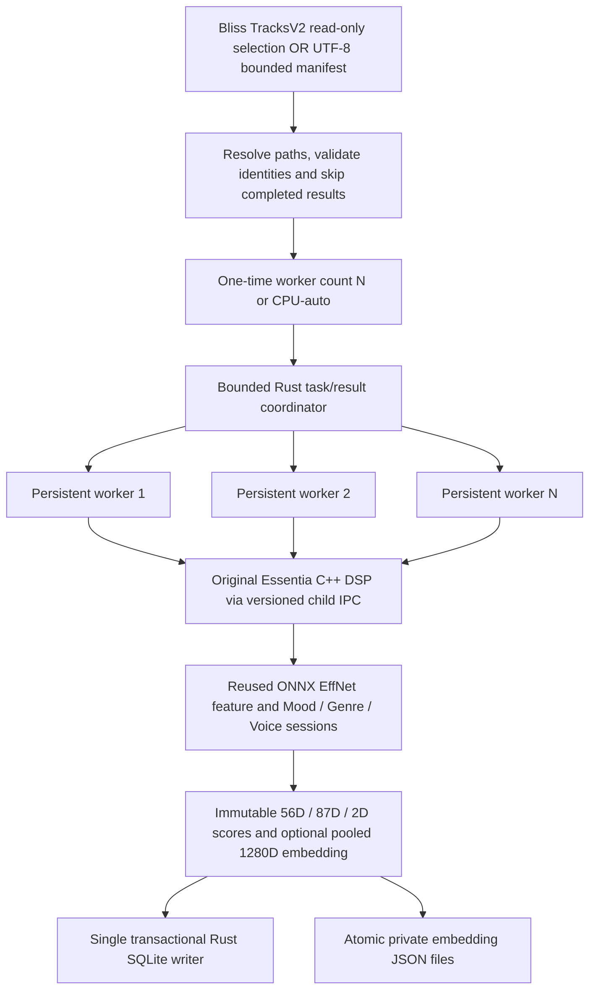

# Final native multi-worker song analysis (static worker capacity)

**Source integration completed:** [PR #20](https://github.com/chrober/bliss-mood-poc/pull/20) was squash-merged to `main` at [`783b05761b6b322a85753acded63ffe336874a6d`](https://github.com/chrober/bliss-mood-poc/commit/783b05761b6b322a85753acded63ffe336874a6d), replacing the stable native/manifest portions of stacked PR [#17](https://github.com/chrober/bliss-mood-poc/pull/17) and [#18](https://github.com/chrober/bliss-mood-poc/pull/18). These historical PRs and experimental [PR #19](https://github.com/chrober/bliss-mood-poc/pull/19) were deliberately closed **without separate merges**, preserving all branch history. The qualified PR20 head and the actual source-tree contents of main are byte-for-byte identical at Git tree level (tree `60695657fad43d00e6a080ba3a617d428e172f97`). See [Similarity handback](handback-multi-worker-to-similarity-20261028.md) for the exact Windows CI build, numerical evidence, and remaining native Windows experimental gate.

## Supported CLI contract

- `scan-features --workers N`: select up to N concurrent song analyses once at startup; **no resizing**. The number actually busy can be lower if fewer songs remain.
- `scan-features --workers auto`: one-time CPU-based selection via `std::thread::available_parallelism()` (process affinity/container constraints *when exposed by the OS*). Reserve `max(floor(logical_cpus/4),2)` CPUs, subject to a lower bound of 1 worker; **cap auto at 8**. This is an approximate interactive-CPU-headroom policy, **not** runtime load sensing and not guaranteed throughput optimum.
- **Default remains `--workers 1`** for compatibility. Explicit numeric values must be in `1..=64` and **no larger than process-visible logical CPU capacity**. Invalid/excessive input is rejected with a diagnostic, never silently clamped. This intentionally rejects oversubscription even when explicitly requested.
- `--threads 1` is required for parallel (`--workers > 1`) scanning to avoid ONNX oversubscription. The same source-scanning, Model Registry and SQLite writer logic is used for any worker count.
- Dynamic arguments `--adaptive-workers`, `--adaptive-policy`, `--min-workers`, `--max-workers`, `--adaptive-min-completed-songs` are **unsupported** and the public CLI rejects them. The resource telemetry is diagnostic, **not** a dynamic controller. Resource/process failures can stop the scan safely without silently resizing workers.
- `--priority normal|below-normal|above-normal` is optional on Windows; on non-Windows it errors if explicitly supplied. Existing automatic priority behavior for `--workers auto` remains a conservative background choice.

## Stable architecture



The diagram is logical: native Essentia C++ child DSP sessions and ONNX inference are reused **per Rust worker**; it does not imply that all Rust threads share a single DSP process. The coordinator bounds the in-flight tasks to the configured static pool and owns output persistence. Existing file identity, read-only source access, model fingerprints, sidecar schema and embedding math must stay unchanged.

## CLI examples

**Example 1: fixed workers with read-only Bliss database and a separate sidecar** (replace paths; do not write into a production music/Bliss database):

```powershell
$exe = '.\bin\windows-x64\VERIFIED\bliss-mood.exe'
& $exe scan-features `
  --bliss-db '.\bliss.db' --db '.\private-feature-sidecar.sqlite' `
  --source-root 'D:\Music' --models-dir '.\models' `
  --models moodtheme,genre,voice `
  --audio-backend essentia --essentia-worker '.\native\bliss-essentia-worker.exe' `
  --workers 4 --threads 1 --max-errors 3 --json
```

**Example 2: explicit manifest and pooled normalized 1280D embeddings, with static CPU-auto**:

```powershell
$exe = '.\bin\windows-x64\VERIFIED\bliss-mood.exe'
New-Item -ItemType Directory -Force '.\private-embeddings' | Out-Null
& $exe scan-features `
  --tracks-file '.\private-cohort.txt' --source-root 'D:\Music' `
  --db '.\private-manifest-sidecar.sqlite' `
  --embedding-dir '.\private-embeddings' --models-dir '.\models' `
  --models moodtheme,genre,voice `
  --audio-backend essentia --essentia-worker '.\native\bliss-essentia-worker.exe' `
  --workers auto --threads 1 --max-errors 3 --json
```

The manifest consists of UTF-8 lines containing exact, source-root-relative, forward-slash-separated track identities. No absolute paths, parent traversal, duplicate identities or cross-root symlinks; audio files are read only. The embedding directory **must already exist** and be outside protected source/model roots; `--embedding-dir` requires `--tracks-file`, is forbidden in `--dry-run`, and must not contain conflicting/corrupted outputs. Skip/resume verifies existing features and embedding files. Untrusted input failures must not overwrite successful existing results. The shared catalog/sidecar database is not a suitable destructive scratch test target.

## Dependencies and delivery boundaries

- Original Essentia C++ backend is opt-in (`--audio-backend essentia`, `--essentia-worker PATH`); the executable must match the scanner IPC protocol and be present in a **trusted, locally approved installation**. It is not implicitly bundled by merging Rust/C++ source. The legacy `--audio-backend rust` remains supported.
- The preconfigured official Discogs-EffNet / Mood-Theme / Genre / Voice ONNX weights and label JSON files must be obtained separately; no third-party model assets or private audio are committed.
- Windows x64 is built using GitHub-hosted Actions; Linux native C++ requires matching Essentia/FFmpeg/ONNX/runtime dependencies. ARM/macOS support is limited by actual platform builds/runs and must not be inferred from generic Rust compilation.
- **Legal/distribution: intentionally NOT APPROVED.** `docs/essentia-licensing-distribution-strategy.md` describes unresolved AGPL/FFmpeg/third-party obligations and an inventory of **17 native packages with missing installed notices**. Source integration into a repository does **not** constitute approval for Windows native kit or binary/DLL redistribution. Packaging CI must keep `distribution_release_status=BLOCKED`, `release_approved=false`; publishing native redistributables requires independent compliance resolution. This status is **explicitly documented, not silently waived by the main source merge**.

## Verification and numerical meaning

Release qualification requires test results against the **actual integration source SHA**, not historic checks on PR #17/18 or experimental PR #19. The full gate includes Rust tests/clippy, exact serial/fixed1/2/4 feature-output parity, 1280D embeddings and atomic resume/skip, corrupted output fail-closed, native worker IPC/concurrency, ONNX head coverage, Windows/Linux builds, and documented native Essentia DSP/reference comparisons. Different notions must not be conflated:

- **Bitwise equality across worker counts**: unchanged serialized feature score bytes / embedding output bytes for a given model, source, and backend.
- **Tolerance-based numeric parity**: a bounded floating-point error against a reference implementation (not bitwise identity).
- **Original Essentia C++ parity**: comparison with an independent native reference at explicitly established tolerance / dataset scope.
- **End-to-end real-music throughput**: separate observational result with host/NAS conditions, not guaranteed by parity tests.

For the archived experimental exploration, four private real-music campaigns (40 complete 100-song scans; exact parity reported) did **not** find an end-to-end winner for adaptive online autotuning. See the source and [four-campaign study in PR #19](https://github.com/chrober/bliss-mood-poc/blob/feat/ram-safe-online-autotune/docs/autotune-real-music-e2e-findings-20261028.md). This is **not** evidence of an optimal fixed worker count across machines. Potential long-scan autotune, resource-aware resizing and the separate isolated ONNX worker remain future research outside the shipped CLI.

## Similarity handback

For the exact approved scanner build, final main commit, hashes, Windows download instructions and safe reuse of the manifest/embedding output in similarity PR #16, consult [handback-multi-worker-to-similarity-20261028.md](handback-multi-worker-to-similarity-20261028.md). The similarity branch, its human listening judgments, methodology and benchmark files are **not changed** by this integration.

## Final integration and research disposition

The main source merge is completed under the user's explicit authorization even though native binary redistribution rights/notice collection are still unapproved. **Do not confuse source code publication with legal clearance for packaging compiled native dependencies.** PR #17/#18 are closed as superseded by the controlled squash integration; PR #19 is closed **without merge** and its branch is retained. [Backlog #21](https://github.com/chrober/bliss-mood-poc/issues/21) tracks possible future long-scan online tuning and ONNX-process isolation. Source paths to the archived experimental benchmark reports remain available on PR #19; no private user audio, databases, models, or reports were committed by this handback.
