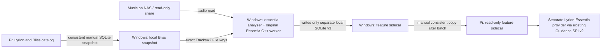

# Initial Lyrion integration: manual offline analysis on Windows

**Decision — 31 October 2026.** Do not launch, schedule or tie
`essentia-analyser` to Lyrion library updates or the scanner lifecycle.
Automatic incremental reanalysis is postponed. The initial large
music-library analysis runs **manually on a Windows PC**, not on the
Raspberry Pi 4B running Lyrion. This is appropriate for a library of
65,000+ songs, for which Pi-side analysis could take more than a day.
No throughput estimate or Windows completion time is guaranteed.

## Responsibility and data flow



Neither a Lyrion rescan, `lastscan`, nor `rescan done` invokes the
analyser. Lyrion does not wait for analysis. The Pi needs no
Essentia C++, FFmpeg, ONNX Runtime or classifier weights merely to
consume completed stored feature rows; the future native SPI provider
is a separate runtime component.

## Windows prerequisite contract

- A verified **local** `essentia-analyser.exe`, plus an independently
  provisioned, version-matched `essentia-worker.exe` and its runtime
  dependencies for `--audio-backend essentia`. They are not automatically
  packaged together by `cargo build`. Follow the project's licensing
  and binary provenance checks; public distribution of an unaudited
  native bundle remains blocked.
- Required model files and the registry (if custom) reside in a Windows
  model directory. The scanner and worker must use matching preprocessing
  and model fingerprints; recording an unvalidated model result does not
  silently make it production-ready.
- A **consistent Bliss SQLite snapshot** obtained from Lyrion via a
  SQLite backup or with all writers stopped. Never copy an open WAL-mode
  `bliss.db` file by itself. The working copy is local to Windows and
  is read-only from the scanner's perspective.
- The audio files are reachable **read-only** from Windows, for example
  through an SMB/UNC music share. Exact `TracksV2.File` values from
  the snapshot must map to files under the supplied `--source-root`.
  A Windows path spelling is not a portable Lyrion root identity.
- The feature SQLite database is written to a **local Windows disk**,
  not into the music tree or an active database on the Pi. Have
  sufficient free space and preserve the same model/sidecar across runs.

## Verified existing CLI pattern (example placeholders only)

Replace these paths with private local paths; no commands below have
been run against the user's collection. All keys assumed relative to
the one exposed share root in this example.

```powershell
$exe        = 'C:\Tools\Essentia\essentia-analyser.exe'
$worker     = 'C:\Tools\Essentia\essentia-worker.exe'
$models     = 'C:\Tools\Essentia\models'
$bliss      = 'C:\Data\Lyrion\bliss-snapshot.db'
$features   = 'C:\Data\Essentia\essentia-features-v3.db'
$sourceRoot = '\\NAS-SERVER\music'

# Start with a bounded smoke batch, not the full 65k library.
& $exe scan-features `
    --bliss-db $bliss --db $features --models-dir $models `
    --models moodtheme,genre --source-root $sourceRoot `
    --audio-backend essentia --essentia-worker $worker `
    --workers auto --threads 1 --priority below-normal `
    --max-new 100 --max-errors 5 --json
if ($LASTEXITCODE -ne 0) { throw 'Feature scan reported errors; inspect output' }
```

`--workers auto` is a **one-time conservative CPU-based selection**, not
dynamic adaptive tuning. You may choose a measured fixed `--workers N`
instead. The scanner's own resource limits apply on the selected
machine. `--threads 1` is required with multiple workers.

After validating the 100-song pilot, run the same command without
`--max-new 100` for the full library, or use controlled incremental
batches. Restarting against the **same sidecar, model fingerprint and
source keys** normally skips successfully completed tracks based on
the persisted file state; failures and new/changed files remain
pending. A later manual run can use a newer consistent Bliss snapshot
without automatically invoking anything on a Lyrion rescan.

### Caveats for multiple music roots

Current `scan-features` resolves one `--source-root` for each invocation
and its SQLite-v3 primary key is `(track_file, model_id)`. A catalog
with two independent relative music roots that contain the same
filename is **ambiguous**; do not arbitrarily merge roots or reuse
relative keys. For an initial pilot either use one unambiguous
catalog/share root or an explicit, verified key-to-source mapping.
Portable multi-root source receipts belong to later work, not an
automatic library-update handler. `--library-root` is needed only
when Bliss keys include a prefix to remove; it is **not** appropriate
for already root-relative keys.

## Manual handoff to the Pi

1. Finish a batch, or use SQLite's **consistent backup API** to
   snapshot the in-progress local v3 sidecar. Do not raw-copy a live
   SQLite WAL file. Ensure all current transactions/sidecars are
   accounted for, and validate integrity on the exported copy.
2. Transfer that **completed SQLite snapshot** to private storage
   reachable by the Lyrion Essentia provider on the Pi.
3. The provider will perform **read-only exact-key/model lookups**
   through the existing Guidance SPI v2 preparation path, with
   bounded provider-side resources. Never decode audio or call the
   offline analyser from the mix/queue/scan path.
4. Missing, stale, mismatched or experimental feature rows must remain
   neutral. Partial coverage is acceptable for early passive
   experiments, and no automatic backfill is triggered.

**Not yet a deployable integration:** as of this decision the
`lms-guidance-essentia` plugin is not installed/available. Its real
host source identity, Windows-to-Pi root mapping, safe data transfer
and experimental unvalidated-head policy require separate testing.
The synthetic SPI test does not prove those real host prerequisites.

## Future work, intentionally deferred

Only later consider Lyrion library-change notifications, a durable
scan-generation/root receipt, incremental queueing, automatic rescans
or Pi-side analysis. Such jobs must be asynchronous, optional and
separate from playlist creation. Do **not** make host scan-triggered
analysis a prerequisite for the first passive SPI integration.

Related: [Scanner source stability Draft PR #6]
(https://github.com/chrober/essentia-analyser/pull/6),
[Lyrion provider Draft PR #1]
(https://github.com/chrober/lms-guidance-essentia/pull/1).
